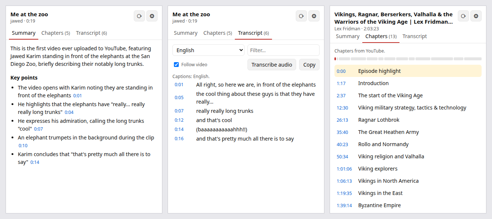
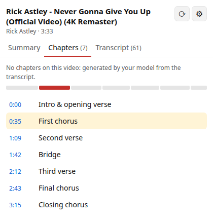
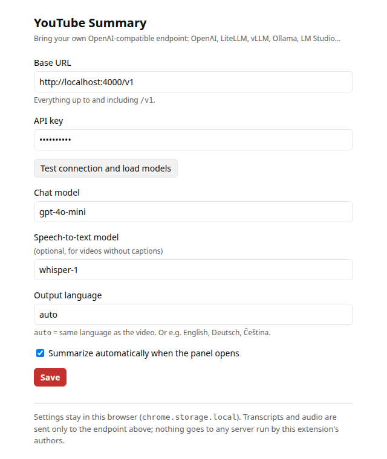

# YouTube Summary: bring your own LLM

A small Chrome / Edge extension (Manifest V3). On a YouTube video, click the toolbar icon to get, in a side panel:

* the **full transcript**, with timestamps that seek the video;
* a **summary** from *your* OpenAI-compatible endpoint (OpenAI, LiteLLM, vLLM, Ollama, LM Studio…);
* a **chapter timeline**: YouTube's own chapters, chapters from the description, or chapters generated by your model when the video has none.

Everything runs in your browser. There is no backend: the extension talks to YouTube and to the one endpoint you configure, and nothing else.





When a video has no chapters, the model proposes them from the timestamped transcript (right). The bar above the list is the timeline; click a chapter or any timestamp to seek. The panel follows the light/dark theme.

<br clear="right">

The caption and audio logic is a small port of what [yt-dlp](https://github.com/yt-dlp/yt-dlp) does, adapted to running inside a youtube.com tab. [`docs/how-youtube-subtitles-work.md`](docs/how-youtube-subtitles-work.md) explains it: InnerTube clients, `captionTracks`, `json3`, PO tokens, signature/`n` challenges, SABR, and why naive summary extensions now get empty transcripts.

## Install (developer mode)

1. Download `ytb-summary-extension-0.1.0.zip` from the [latest release](https://github.com/bigbatmanorg/ytb-summary-extension/releases/latest) and unzip it. Or clone this repo; there is no build step.
2. Open `chrome://extensions` (Edge: `edge://extensions`) and turn on **Developer mode**.
3. Click **Load unpacked** and pick the folder that contains `manifest.json`.
4. The settings page opens. Fill it in, then open any `youtube.com/watch?v=…` page and click the extension's icon (pin it from the puzzle-piece menu).

Requires Chrome / Edge 116 or newer (side panel API).

## Settings



| Setting | Example | Notes |
|---|---|---|
| Base URL | `https://api.openai.com/v1`, `http://localhost:4000/v1` | Everything up to and including `/v1`. On save, the browser asks permission to reach that host (only that host). |
| API key | `sk-…` | Sent only as `Authorization: Bearer …` to the base URL. Can be empty for local servers. |
| Chat model | `gpt-4o-mini`, `brain` | Used for the summary and AI chapters. **Test connection** lists `/v1/models`. |
| Speech-to-text model | `whisper-1` | Optional. Used for videos without captions (`/v1/audio/transcriptions`). |
| Output language | `auto`, `English`, `Deutsch` | `auto` writes the summary in the video's language. |
| Summarize automatically | on | Off = only the transcript loads; press **Summarize** yourself. |

Settings live in `chrome.storage.local` and are not synced.

## How it works

```
toolbar click → side panel (extension page)
   │  chrome.tabs.sendMessage
   ▼
content script on youtube.com ── same-origin fetch ──► /youtubei/v1/player, /next, /api/timedtext
   │ window.postMessage
   ▼
page script (MAIN world) ── #movie_player.getPlayerResponse(), ytcfg, the player's own timedtext PO token
side panel ── fetch ──► *.googlevideo.com audio (STT only) and ──► your /v1 endpoint
```

Captions, cheapest and least intrusive first (`src/lib/youtube.js`):

1. the page player's own caption tracks, if they need no PO token;
2. InnerTube `ANDROID_VR` / `VISIONOS` (the "JS-less" clients yt-dlp uses): their caption URLs need no PO token;
3. the page's tracks plus the **PO token the YouTube player itself attached** to its last caption request. If there is none, CC is switched on for a moment and back off.

No captions at all → **speech-to-text**. The smallest audio-only stream is downloaded in ≤10 MiB range requests, cut into ≤20 MB pieces at MP4 fragment boundaries (init segment + whole fragments, so each piece is a valid file and nothing is re-encoded), and posted to `/audio/transcriptions`. Timestamps are offset per piece.

Long transcripts (over about 60k characters) are condensed part by part, then summarized ("map-reduce"), so long videos also fit models with smaller contexts.

`src/lib/` is plain ES modules with no dependencies. The same code runs in the extension and in Node:

```bash
node scripts/cli.mjs https://www.youtube.com/watch?v=dQw4w9WgXcQ
```

```bash
node scripts/cli.mjs dQw4w9WgXcQ --summary
```

The second command uses `.env.local` (see below).

## Privacy

* **No servers of ours.** The extension has no backend, analytics or telemetry.
* The transcript (and, for STT, the audio) goes **only to the base URL you configured**, with your key.
* Requests to YouTube are the same ones the site makes (InnerTube, timedtext, googlevideo), sent from your browser. InnerTube calls are made **without your cookies** (anonymous), so your YouTube account is not involved.
* Permissions: `youtube.com` and `googlevideo.com` (captions, audio); your endpoint's host, requested at runtime; `sidePanel`, `storage`, `tabs`, `scripting` (to inject into tabs that were open before install).
* Results are cached per video in `chrome.storage.session` (cleared when the browser closes).

## Limitations (v0.1.0, November 2026)

* **YouTube's bot check.** When YouTube flags your network ("Sign in to confirm you're not a bot"), the JS-less clients stop answering. Captions still work through step 3, but **speech-to-text has no audio URL**, and the panel says so. The web player itself only streams SABR, which has no plain audio URL to reuse. A future option is recording the tab's audio in real time.
* **PO-token step needs a real browser session.** In automated or headless Chromium (Playwright), YouTube rejects the player's tokens, so that path can't be tested in CI. It was verified by hand in a regular browser.
* Pre-roll ads delay step 3: the player fetches the ad's captions first. The extension waits up to 45 s.
* Live streams, premieres, members-only and age-restricted videos get no special handling.
* YouTube changes all of this regularly. Client versions in `src/lib/innertube.js` follow yt-dlp 2026.10.21.
* STT accuracy and timestamps depend on your model. Through LiteLLM, `verbose_json` comes back as one segment per file, so the extension asks for `vtt`.

## Development

```bash
npm test
```

Runs the Node unit tests over the recorded fixtures in `test/fixtures/`.

```bash
npm install
```

Installs Playwright, which only the end-to-end run needs.

```bash
node scripts/e2e.mjs dQw4w9WgXcQ iKx3gAODybU
```

Headless Chromium loads the unpacked extension, opens each video and checks the panel. Add `--stt` to force the speech-to-text path.

```bash
npm run zip
```

Builds `dist/ytb-summary-extension-<version>.zip`.

The end-to-end script and the CLI read the endpoint from a gitignored `.env.local`:

```
YTSUM_BASE_URL=http://localhost:4000/v1
YTSUM_API_KEY=sk-...
YTSUM_CHAT_MODEL=gpt-4o-mini
YTSUM_STT_MODEL=whisper-1
```

| Path | What |
|---|---|
| `src/lib/innertube.js` | InnerTube client contexts, `getPlayerResponse`, `/next` |
| `src/lib/captions.js` | `listCaptionTracks`, `pickTrack`, `fetchTranscript` (json3 → `{start,end,text}`), VTT parser |
| `src/lib/chapters.js` | `getChapters`: player bar, engagement panel, description |
| `src/lib/audio.js` | `getAudioUrl`, `sidx` parser, chunked download |
| `src/lib/openai.js` | `/chat/completions`, `/audio/transcriptions`, `/models` |
| `src/lib/summarize.js` | prompts, map-reduce, reply parsing |
| `src/content.js`, `src/page.js` | youtube.com content script (isolated world) and page script (MAIN world) |
| `src/panel/`, `src/options/` | side panel and settings UI |

## License

[MIT](LICENSE)
